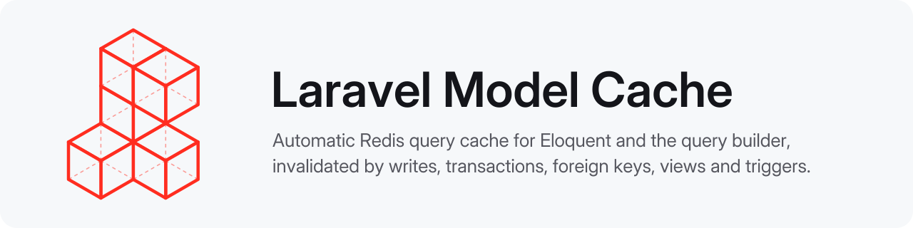
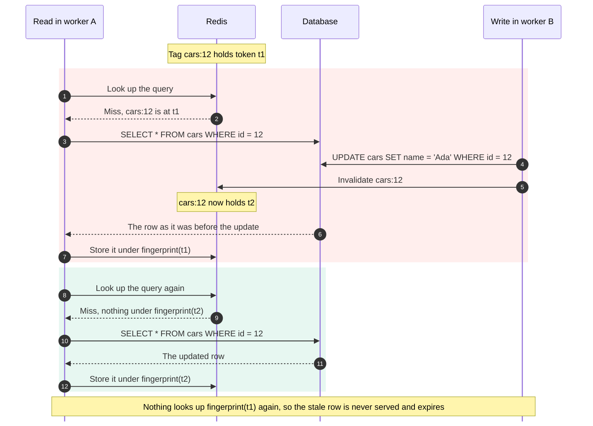
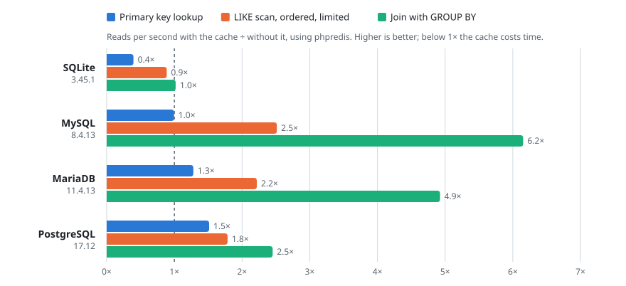

<picture>
  <source media="(prefers-color-scheme: dark)" srcset="art/banner-dark.svg">
  
</picture>

<p align="center">
  <a href="https://github.com/Kontainer-Dam-and-Pim/laravel-model-cache/actions/workflows/tests.yml"></a>
  <a href="#development"></a>
  <a href="phpstan.neon.dist"></a>
  <a href="https://packagist.org/packages/kontainer/laravel-model-cache"></a>
  <a href="https://packagist.org/packages/kontainer/laravel-model-cache"></a>
  <a href="https://packagist.org/packages/kontainer/laravel-model-cache"></a>
  <a href="LICENSE"></a>
</p>

- **Drop-in.** One trait on your base model, and Eloquent and `DB::table()` reads are cached while every write invalidates them.
- **Never stale after a write.** A result read while a write runs is unreachable afterwards, not served.
- **Follows the database.** Raw SQL, transactions, foreign key cascades, views, triggers and PostgreSQL partitions all invalidate what they change.
- **Fails safe.** When Redis is down, queries go to the database, and rejected invalidations are replayed.
- **One Redis round trip per cache hit**, which serves joins and scans [several times faster](#benchmarks) than MySQL, MariaDB or PostgreSQL.
- **Every line tested** on SQLite, MySQL, MariaDB and PostgreSQL with phpredis and Predis.

Started as a fork of [spiritix/lada-cache](https://github.com/spiritix/lada-cache). See [Migrating from Lada Cache](#migrating-from-lada-cache) for what changed and how to switch.

- [Requirements](#requirements)
- [Compatibility](#compatibility)
- [Installation](#installation)
- [Usage](#usage)
- [Configuration](#configuration)
- [Guarantees](#guarantees)
- [Invalidation](#invalidation)
- [What is not cached](#what-is-not-cached)
- [Operating it](#operating-it)
- [Console commands](#console-commands)
- [Metrics](#metrics)
- [Benchmarks](#benchmarks)
- [Limitations](#limitations)
- [Migrating from Lada Cache](#migrating-from-lada-cache)
- [Development](#development)
- [License](#license)

## Requirements

| Component | Version                                                        |
|-----------|----------------------------------------------------------------|
| PHP       | 8.3+                                                           |
| Laravel   | 13.40+                                                         |
| Redis     | Standalone server, optionally with replicas and Sentinel       |
| Client    | phpredis or Predis                                             |
| Databases | MySQL, MariaDB, PostgreSQL, SQLite, SQL Server                 |
| Optional  | APCu, to share failure state across PHP-FPM processes          |

The versions actually tested are listed under [Compatibility](#compatibility).

## Compatibility

<!-- compatibility:start -->
Generated by [CI](https://github.com/Kontainer-Dam-and-Pim/laravel-model-cache/actions/runs/43954413740). Each cell runs the Unit and Integration suites against Redis 7.4.12, phpredis 6.3.0. "lowest" resolves every dependency to the oldest version `composer.json` allows, "highest" to the newest.

<details>
<summary>All 24 PHP, Laravel and database combinations pass</summary>

| PHP | Laravel | SQLite 3.45.1 | MySQL 8.4.13 | MariaDB 11.4.13 | PostgreSQL 17.12 |
|---|---|---|---|---|---|
| 8.3.36 | 13.40.0 (lowest) | ✅ | ✅ | ✅ | ✅ |
| 8.3.36 | 13.42.0 (highest) | ✅ | ✅ | ✅ | ✅ |
| 8.4.27 | 13.40.0 (lowest) | ✅ | ✅ | ✅ | ✅ |
| 8.4.27 | 13.42.0 (highest) | ✅ | ✅ | ✅ | ✅ |
| 8.5.12 | 13.40.0 (lowest) | ✅ | ✅ | ✅ | ✅ |
| 8.5.12 | 13.42.0 (highest) | ✅ | ✅ | ✅ | ✅ |

</details>

<details>
<summary>All 14 runs of the deeper suites pass, on the locked dependencies</summary>

| Suite | Database | Redis client | PHP | Result |
|---|---|---|---|---|
| Concurrency | MySQL 8.4.13 | phpredis 6.3.0 | PHP 8.4.27 | ✅ |
| Concurrency | MySQL 8.4.13 | Predis 3.7.1 | PHP 8.4.27 | ✅ |
| Concurrency | PostgreSQL 17.12 | phpredis 6.3.0 | PHP 8.4.27 | ✅ |
| Concurrency | PostgreSQL 17.12 | Predis 3.7.1 | PHP 8.4.27 | ✅ |
| Fuzz | SQLite 3.45.1 | phpredis 6.3.0 | PHP 8.4.27 | ✅ |
| Fuzz | SQLite 3.45.1 | Predis 3.7.1 | PHP 8.4.27 | ✅ |
| Fuzz | MySQL 8.4.13 | phpredis 6.3.0 | PHP 8.4.27 | ✅ |
| Fuzz | MySQL 8.4.13 | Predis 3.7.1 | PHP 8.4.27 | ✅ |
| Fuzz | PostgreSQL 17.12 | phpredis 6.3.0 | PHP 8.4.27 | ✅ |
| Fuzz | PostgreSQL 17.12 | Predis 3.7.1 | PHP 8.4.27 | ✅ |
| Integration | SQLite 3.45.1 | Predis 3.7.1 | PHP 8.4.27 | ✅ |
| Integration | MySQL 8.4.13 | Predis 3.7.1 | PHP 8.4.27 | ✅ |
| Integration | MariaDB 11.4.13 | Predis 3.7.1 | PHP 8.4.27 | ✅ |
| Integration | PostgreSQL 17.12 | Predis 3.7.1 | PHP 8.4.27 | ✅ |

</details>
<!-- compatibility:end -->

## Installation

```bash
composer require kontainer/laravel-model-cache
php artisan vendor:publish --provider="Kontainer\ModelCache\ModelCacheServiceProvider"
```

The service provider is registered through package discovery. It replaces the database connections of every supported driver with caching subclasses, so `DB::table()` and Eloquent queries go through the cache without code changes.

Add the trait to your models, ideally on a shared base model:

```php
use Illuminate\Database\Eloquent\Model;
use Kontainer\ModelCache\Database\ModelCacheTrait;

abstract class BaseModel extends Model
{
    use ModelCacheTrait;
}
```

Give the cache its own Redis connection with short timeouts. A Redis that stops answering without closing the connection stalls every query for as long as the client waits:

```php
// config/database.php, under 'redis'
'model-cache' => [
    'host' => env('REDIS_HOST', '127.0.0.1'),
    'port' => env('REDIS_PORT', '6379'),
    'database' => env('REDIS_CACHE_DB', '1'),
    'timeout' => 1.0,            // connect, both clients
    'read_timeout' => 1.0,       // phpredis
    'read_write_timeout' => 1.0, // Predis
],
```

```dotenv
MODEL_CACHE_REDIS_CONNECTION=model-cache
```

## Usage

Reads are cached and writes invalidate automatically:

```php
Car::query()->where('driver_id', 5)->get();      // miss: runs the query, stores the result
Car::query()->where('driver_id', 5)->get();      // hit: one Redis round trip
Car::query()->whereKey(12)->update(['name' => 'Ada']);
Car::query()->where('driver_id', 5)->get();      // miss if car 12 can be in the result
```

Read one query from the database without caching it:

```php
User::query()->whereKey($id)->withoutCache()->first();
DB::table('users')->where('active', true)->withoutCache()->get();
```

`withoutCache()` only affects the read. Writes always invalidate.

Cache only reads made by models that use `ModelCacheTrait`. Writes from any builder still invalidate those models' entries:

```dotenv
MODEL_CACHE_SCOPE=models
```

Invalidate tables after changes made outside Laravel, such as imports or a database console:

```bash
php artisan model-cache:invalidate users orders --connection=mysql
```

Declare dependencies the schema does not show, such as tables written by stored procedures that a trigger calls:

```php
// config/model-cache.php
'dependent_tables' => [
    'orders' => ['order_totals'],
],
```

## Configuration

`config/model-cache.php`:

| Key                         | Environment variable              | Default        | Effect |
|-----------------------------|-----------------------------------|----------------|--------|
| `active`                    | `MODEL_CACHE_ACTIVE`              | `true`         | Enables the cache. When `false`, the default Laravel connections are used. |
| `redis_connection`          | `MODEL_CACHE_REDIS_CONNECTION`    | `cache`        | Redis connection from `config/database.php`. |
| `prefix`                    | `MODEL_CACHE_PREFIX`              | `model-cache:` | Key prefix. Applications sharing a Redis database need distinct prefixes. |
| `expiration_time`           | `MODEL_CACHE_EXPIRATION`          | `604800` (7 d) | Entry TTL in seconds. `0` disables expiration. |
| `expiration_jitter`         | `MODEL_CACHE_EXPIRATION_JITTER`   | `15`           | Spreads each TTL randomly by up to this percentage in either direction. |
| `max_entry_size`            | `MODEL_CACHE_MAX_ENTRY_SIZE`      | `8388608`      | Results larger than this many bytes are returned but not stored. `0` means no limit. |
| `replica_lag`               | `MODEL_CACHE_REPLICA_LAG`         | `2`            | Seconds after a write during which reads of the table from a read replica are not stored. |
| `consider_rows`             | `MODEL_CACHE_CONSIDER_ROWS`       | `true`         | Tag reads by primary key so writes invalidate only reads that can contain their rows. `false` tags whole tables. |
| `scope`                     | `MODEL_CACHE_SCOPE`               | `all`          | `all` caches every read on a caching connection, `models` only reads from models using `ModelCacheTrait`. |
| `include_tables`            |                                   | `[]`           | When not empty, only queries whose tables are all listed are cached, and `exclude_tables` is ignored. |
| `exclude_tables`            |                                   | `[]`           | Queries touching a listed table are not cached. |
| `dependent_tables`          |                                   | `[]`           | Extra tables to invalidate when a table is written: `'orders' => ['order_totals']`. |
| `metrics`                   | `MODEL_CACHE_METRICS`             | `false`        | Count hits, misses, invalidations and more (see [Metrics](#metrics)). |
| `metrics_bucket_seconds`    | `MODEL_CACHE_METRICS_BUCKET`      | `3600`         | Width of one metrics bucket. |
| `metrics_retention_seconds` | `MODEL_CACHE_METRICS_RETENTION`   | `691200` (8 d) | How long a metrics bucket is kept. |
| `enable_debugbar`           | `MODEL_CACHE_ENABLE_DEBUGBAR`     | `true`         | Register a collector with `fruitcake/laravel-debugbar` when it is installed. |

Tables Laravel writes on nearly every request are always excluded when sessions, the cache, queues, failed jobs or job batches use the database.

An invalid value, such as an unknown `scope` or a negative `expiration_time`, disables the cache and logs an error at boot. The application keeps working.

## Guarantees

**No stale reads after a write.** Every tag has a random version token. A read captures its tags' tokens before querying the database and stores the result under their fingerprint. A write replaces the tokens of the tags it affects. A result read before a concurrent write therefore becomes unreachable rather than stale. Lookups, stores and invalidations are each a single atomic Lua script.



**Schema changes retire the whole cache.** Entries live under a random generation id. These replace the id for every host sharing the Redis database in one atomic step:

- each completed migration;
- `schema:load` and `migrate:fresh`/`refresh`;
- raw DDL run through Laravel;
- `model-cache:flush`.

Inside a transaction, the retire happens again at commit. A query that started before the switch never stores a result that is served afterwards. Retired keys are pruned in bounded `SCAN` batches when a migration batch ends.

**Redis failures never break database access.** A failed cache operation is logged and the query runs against the database. After a failure, Redis is skipped for 30 seconds. That skip lasts the worker's lifetime under Octane or FrankenPHP, and is shared across PHP-FPM processes through APCu when it is installed.

**Failed invalidations are replayed.** An invalidation Redis rejects is kept and logged as an error, and reads bypass the cache until it is replayed. Replay happens before the cache is used again, and again when the request, job or worker ends. Under PHP-FPM, pending invalidations are shared through APCu. Very large backlogs retire the whole cache instead.

**A replaced Redis server is detected.** A restarted server or a promoted replica may have lost recent invalidations. The cache records the server's run id and retires the generation the first time a store or invalidation reaches a different server. Lookups check this on each process's first lookup and then every 5 seconds.

**An emptied Redis never revives old entries.** Generation ids are random, so an emptied or restarted Redis starts a fresh generation.

## Invalidation

### Builder and Eloquent writes

| Write                                                         | Invalidates |
|---------------------------------------------------------------|-------------|
| `update()` / `delete()` pinned to primary keys                | Reads that can contain those rows, plus table-wide reads |
| `update()` / `delete()` with other conditions                 | Every read of the table |
| `insert()`, `insertGetId()`, `insertOrIgnore()`, `upsert()`   | Table-wide reads and cached lookups of the inserted keys |
| `truncate()`                                                  | Every read of the table and of every table referencing it |
| A write that affects no rows                                  | Its own table and statement-level triggers, but no foreign keys |

### Raw statements

Statements run through the connection are classified by parsing their SQL with the dialect of the connection. This covers `DB::insert()`, `DB::update()`, `DB::delete()`, `DB::statement()`, `DB::affectingStatement()`, `DB::unprepared()`, and `DB::select()` with `INSERT ... RETURNING`.

| Statement                                                        | Effect |
|------------------------------------------------------------------|--------|
| Single-table `INSERT`, `UPDATE`, `DELETE`, `MERGE`               | Invalidates that table |
| Multi-table `UPDATE` / `DELETE`                                  | Invalidates each written table, resolved through aliases |
| DDL, procedure calls, writable CTEs, multiple statements, SQL that cannot be parsed | Retires the whole cache |
| Reads, `SET`, `PRAGMA`, savepoints, locks, temporary tables      | Nothing |

### Changes the database makes along with a write

Each of these is read from the schema once per generation:

- **Foreign keys.**
  - Deletes follow `ON DELETE` rules. Updates follow `ON UPDATE` rules, but only when they assign a referenced column. A truncate reaches every referencing table. Cascades are followed transitively.
  - A delete pinned to primary key values narrows single-column `CASCADE` and `SET NULL` keys to the child rows that reference those values. For example, `Pet::where('owner_id', 2)` stays cached after owner 1 is deleted.
  - Keys are compared the way the column type compares them: integers cast (`'05'` is 5), decimals compare by value, text is exact, and UUIDs ignore case, hyphens and braces.
  - The child table is invalidated as a whole for values its type cannot key, for deeper cascades, for `SET DEFAULT`, and for other column types.
- **Views.** Reads of a view are invalidated by writes to its base tables. Writes through an updatable view invalidate its base tables.
- **Triggers.** A write invalidates the tables written by triggers on its event (`INSERT`, `UPDATE [OF columns]`, `DELETE`, `TRUNCATE`). A trigger body that cannot be parsed is logged and retires the cache on the writes that fire it.
- **PostgreSQL inheritance and partitions.** Writes to a partition invalidate reads of its parent. Writes to the parent invalidate reads of its partitions. A write to one partition leaves the other partitions cached.
- **Undeclared dependencies.** These come from `dependent_tables`.

If the schema cannot be read, every write retires the cache and the schema is read again after a minute.

### Transactions

- Reads inside a transaction go to the database.
- Invalidations run when the outermost transaction commits. A rollback discards them. A savepoint rollback keeps those of the enclosing transaction.
- A transaction opened outside Laravel (raw `START TRANSACTION`, or directly on the PDO object) is detected from the driver. Its invalidations run at the raw `COMMIT`/`ROLLBACK`, or with the next query after it ends.

### Table names

Tables are tagged by their lower-case name. `UPDATE OWNERS` therefore reaches reads of `owners` regardless of the database's case sensitivity. Reads are tagged with every table their SQL names, including tables inside raw expressions such as `whereRaw('exists (select 1 from pets ...)')`.

## What is not cached

- Queries whose result depends on when or by whom they run, such as `NOW()`, `CURRENT_TIMESTAMP`, `RAND()`, `UUID()` or `date('now')`. Pass such values as bindings to keep the query cacheable:

  ```php
  Order::query()->where('created_at', '>', now()->subDay())->get(); // cached
  Order::query()->whereRaw('created_at > NOW() - INTERVAL 1 DAY')->get(); // not cached
  ```

- Reads inside a transaction.
- Raw reads through `DB::select()`.
- Reads whose `FROM` clause the parser cannot map to tables.
- Results larger than `max_entry_size`.
- Replica reads of tables written within the last `replica_lag` seconds. Reads on the write connection, sticky reads and `useWritePdo()` reads are cached as usual.
- Queries touching excluded tables, or tables missing from `include_tables`.

Reads are assumed to have no side effects. Use `withoutCache()` for queries that call database functions which write data or depend on state outside their tables.

## Operating it

- **Every host that writes must run with the cache active**, against the same Redis database as the hosts serving traffic. This includes queue workers, schedulers and the host running migrations. A host with the cache disabled invalidates nothing. After any period in which that happened, run `php artisan model-cache:flush`.
- **Schema changes are detected from Laravel events only.** Nothing polls the database.
- **Set a Redis eviction policy** such as `allkeys-lru` or `volatile-lru`. Evicted entries and tokens only cause misses. Under `noeviction`, a full Redis rejects invalidations. `volatile-ttl` evicts the short-lived replica markers first.
- **Session settings are not part of the cache key.** If code changes settings that alter results, such as the session time zone for `TIMESTAMP` columns, use a separate connection or `withoutCache()`.
- **Changing the prefix or the Redis database starts the cache cold.**

## Console commands

| Command | Effect |
|---------|--------|
| `model-cache:flush` | Retires every entry in one Redis command, then deletes leftover keys in `SCAN` batches (about 1 s per million keys). |
| `model-cache:invalidate <tables>... [--connection=]` | Invalidates the given tables and everything the database changes along with them. |
| `model-cache:stats [--hours=24] [--table=] [--json]` | Reports collected metrics. |

## Metrics

With `MODEL_CACHE_METRICS=true`, `model-cache:stats` reports:

- **Per table:** hits, misses, hit rate, stores, stores per hit, results too large to store, invalidations caused, and average cascade reach. Stores per hit above 1 means entries are invalidated before they are read.
- **In total:** retires by reason, bypasses by reason, failures by operation, and the statement shapes that ran uncached or retired the cache.

```bash
php artisan model-cache:stats --hours=6 --table=orders
php artisan model-cache:stats --json
```

Cost:

- With metrics off, the Redis scripts and their arguments are unchanged.
- Hits, misses, stores, invalidations and retires are counted by the script that performs them (one `HINCRBY`, no extra round trip).
- Counts only PHP sees are written once per request or job, and at most every 10 seconds by long-lived workers.

Counters are kept per time bucket, outside the cache generation, so flushes and migrations keep them. A query is counted under its first table.

## Benchmarks

<!-- benchmarks:start -->
Generated by [CI](https://github.com/Kontainer-Dam-and-Pim/laravel-model-cache/actions/runs/43954413740) on PHP 8.4.27 with Redis 7.4.12. Reads per second without the cache → with it, each the median of 5 alternating rounds of 2,000 reads cycling through 50 distinct queries on 2,000 rows, all cached reads being hits. Both Redis clients of a database are measured one after the other on the same runner. Every cached read takes exactly one Redis command. The runners are shared, so compare the ratios rather than the absolute numbers.

<picture><source media="(prefers-color-scheme: dark)" srcset="art/benchmarks-dark.svg"></picture>

<details>
<summary>Reads per second on every database and Redis client</summary>

| Database | Redis client | Primary key lookup | LIKE scan, ordered, limited | Join with GROUP BY |
|---|---|---|---|---|
| SQLite 3.45.1 | phpredis 6.3.0 | 13,373 → 4,327 (0.3×) | 3,817 → 3,272 (0.9×) | 3,546 → 3,495 (1.0×) |
| SQLite 3.45.1 | Predis 3.7.1 | 13,481 → 4,501 (0.3×) | 3,800 → 3,095 (0.8×) | 3,555 → 3,512 (1.0×) |
| MySQL 8.4.13 | phpredis 6.3.0 | 2,537 → 2,846 (1.1×) | 959 → 2,187 (2.3×) | 416 → 2,393 (5.8×) |
| MySQL 8.4.13 | Predis 3.7.1 | 2,562 → 2,808 (1.1×) | 968 → 2,192 (2.3×) | 421 → 2,277 (5.4×) |
| MariaDB 11.4.13 | phpredis 6.3.0 | 4,584 → 4,441 (1.0×) | 1,514 → 3,357 (2.2×) | 677 → 3,425 (5.1×) |
| MariaDB 11.4.13 | Predis 3.7.1 | 4,567 → 4,227 (0.9×) | 1,514 → 3,243 (2.1×) | 675 → 3,329 (4.9×) |
| PostgreSQL 17.12 | phpredis 6.3.0 | 2,105 → 3,470 (1.6×) | 1,445 → 2,644 (1.8×) | 1,187 → 2,833 (2.4×) |
| PostgreSQL 17.12 | Predis 3.7.1 | 2,167 → 3,369 (1.6×) | 1,438 → 2,671 (1.9×) | 1,254 → 2,794 (2.2×) |

</details>
<!-- benchmarks:end -->

The cache pays off when the database is a server and the query does real work. SQLite runs inside the PHP process, so a Redis round trip costs more than the query, and a primary key lookup on MySQL is about as fast as the round trip that replaces it.

## Limitations

- Redis Cluster is not supported, because each operation is one Lua script that touches keys of several tags.
- Writes that bypass Laravel's connection are not seen. This includes other applications, database consoles and `DB::connection()->getPdo()`. Use `model-cache:invalidate` or `model-cache:flush` after them.
- Row-level tagging needs a single-column primary key. Composite keys fall back to table-level tags.
- Third-party packages with their own query builder classes bypass the cache.
- Two tables whose names differ only in case share their tags.

## Migrating from Lada Cache

This package began as a fork of [Lada Cache](https://github.com/spiritix/lada-cache) by Matthias Isler, and keeps its approach: caching connection subclasses, a model trait, and row- and table-level tags. The caching and invalidation core has been rewritten.

### What changed

Compared with Lada Cache 6.x:

| | Lada Cache 6.x | Laravel Model Cache |
|---|---|---|
| Read racing a write | A read that started before a write can store its result after the write invalidated, and that result is served until it expires | The result is stored under the tag versions it read, so it is unreachable after the write ([Guarantees](#guarantees)) |
| Redis commands per cache hit | `EXISTS`, `GET`, and one `SADD` per tag | One Lua script |
| Default expiration | Never | 7 days, with jitter |
| Failed invalidation | Skipped silently | Logged, kept and replayed. Reads bypass the cache until then |
| Raw writes (`DB::update()`, `DB::statement()`, ...) | Not seen | Parsed and invalidated. DDL retires the cache |
| Foreign keys, views, triggers, partitions | Not followed | Followed ([Invalidation](#invalidation)) |
| Migrations | `KEYS` scan and delete after the batch | Atomic generation switch, then bounded `SCAN` pruning |
| Replaced or emptied Redis | Not detected | Detected; the cache is retired |
| `withoutCache()` on a write | Skips the invalidation | Still invalidates |
| Time- and randomness-dependent SQL (`NOW()`, `RAND()`) | Cached | Not cached |
| Redis Cluster | | Not supported ([Limitations](#limitations)) |

### Switching

1. Flush the old cache while Lada Cache is still installed: `php artisan lada-cache:flush`.
2. Replace the package:

   ```bash
   composer remove spiritix/lada-cache
   composer require kontainer/laravel-model-cache
   php artisan vendor:publish --provider="Kontainer\ModelCache\ModelCacheServiceProvider"
   ```

3. Rename what your code and configuration refer to:

   | Lada Cache | Laravel Model Cache |
   |---|---|
   | `Spiritix\LadaCache\Database\LadaCacheTrait` | `Kontainer\ModelCache\Database\ModelCacheTrait` |
   | `config/lada-cache.php` | `config/model-cache.php` |
   | `LADA_CACHE_*` environment variables | `MODEL_CACHE_*`, with the same suffixes |
   | `lada-cache:flush` | `model-cache:flush` |
   | `lada-cache:enable`, `lada-cache:disable` | `MODEL_CACHE_ACTIVE`, set on every host at once |

4. Review the defaults that differ: `prefix` is `model-cache:` instead of `lada:`, and `expiration_time` is 7 days instead of never.
5. Give the cache a Redis connection with short timeouts, as shown under [Installation](#installation).
6. Deploy to every host that writes at once, including queue workers and schedulers. A host still running Lada Cache invalidates only Lada Cache's keys ([Operating it](#operating-it)).

## Development

The Nix flake provides PHP 8.4 with the required extensions, Composer and `just`. The databases run in containers on ports 13306 (MySQL), 13307 (MariaDB), 15432 (PostgreSQL) and 16379 (Redis). The databases keep their data in memory without syncing it to disk, since every test recreates its schema, so their contents are gone when the containers stop.

```bash
nix develop                     # or: direnv allow
just test                       # SQLite with phpredis
just test-mysql                 # also test-mariadb, test-pgsql
just test-matrix                # every database with phpredis and Predis
just test --filter=RowKeysTest
just fuzz                       # MODEL_CACHE_FUZZ_ITERATIONS, MODEL_CACHE_FUZZ_SEED
just concurrency                # forked workers sharing one database and Redis
just coverage                   # Unit and Integration on every database, fails below 100% line coverage
just bench
just format                     # Pint
just lint analyse               # Pint check and PHPStan
```

| Suite       | Covers |
|-------------|--------|
| Unit        | Individual classes |
| Integration | Behaviour against a real database and Redis |
| Fuzz        | Seeded random workloads, comparing every cached read with the uncached query |
| Concurrency | Parallel processes, checking cached reads against the database afterwards |
| Benchmark   | Throughput with and without the cache, and Redis commands per cached read |

CI fails unless the Unit and Integration suites, run on every database and with both Redis clients, together cover every line of `src`.

## License

MIT. See [LICENSE](LICENSE) and [NOTICE](NOTICE). Based on [Lada Cache](https://github.com/spiritix/lada-cache), copyright Matthias Isler, also MIT.
